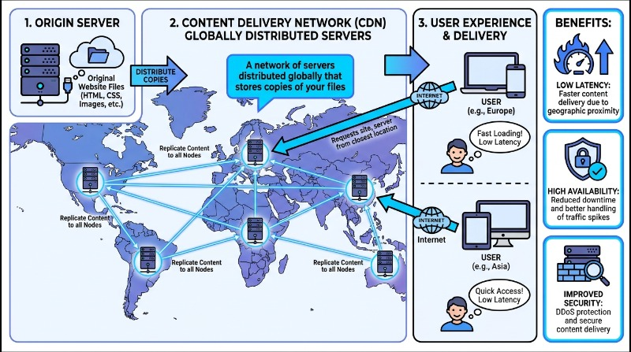
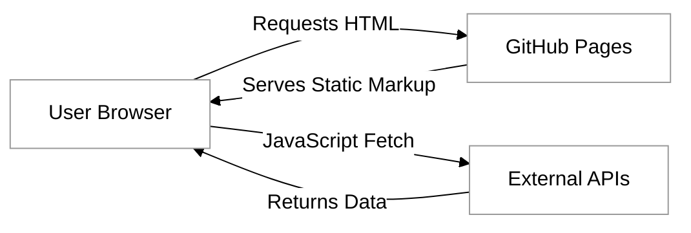
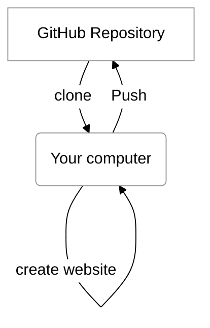
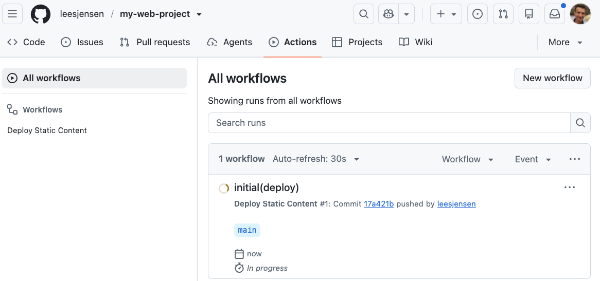
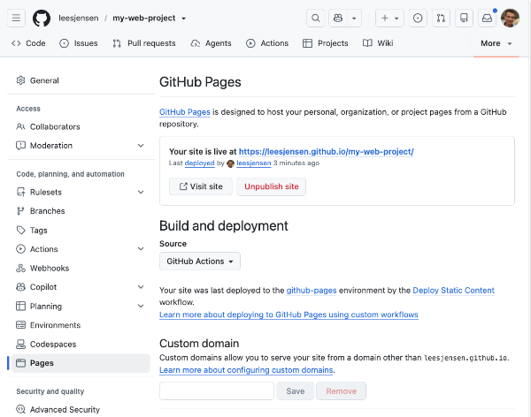
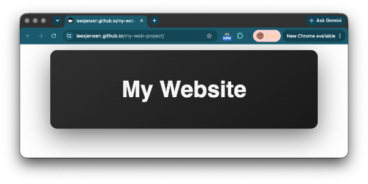

# GitHub Pages

## CDNs and Static Hosting

As you build your web applications, you will quickly reach a point where viewing your work on a local machine is no longer enough. To share your creations with the world, you need a host—a computer that is always on and connected to the internet. Modern web hosting often utilizes **Content Delivery Networks (CDNs)**. A CDN is a network of servers distributed globally that stores copies of your files. When a user requests your site, the CDN serves the files from the location geographically closest to them. This provides a high-performance solution for static hosting, ensuring low latency, high availability, and improved security.




### Understanding Static Web Hosting and the Jamstack

A _static_ website consists of files such as HTML, CSS, JavaScript, and images that are delivered to the user's browser exactly as they are stored on the server. Unlike dynamic websites that use server-side languages like Python, Ruby, or Next.js to build pages on the fly, static hosts simply serve the files you have written.

While this may sound limiting, modern web development often leans into a **Jamstack** architectural approach where your "static" site behaves like a dynamic one by shifting the work from the server to the browser.

The name jamstack is an acronym for its three core components:

*   **J**avaScript: Handles all dynamic logic on the client-side (e.g., React, Vue, or vanilla JS).
*   **A**PIs: Instead of your own server, you use external services via JavaScript to handle data (like fetching weather info or user comments).
*   **M**arkup: Pre-rendered HTML files that are served instantly from a host like GitHub Pages.



By serving pre-built files and using APIs for data, your site becomes incredibly fast and secure because there is no database or server-side language for hackers to attack directly. GitHub Pages is perfect for portfolio sites, documentation, and the frontend of your web applications.


## GitHub Pages

While several platforms offer static hosting, such as Cloudflare Pages, Netlify, and Vercel, **GitHub Pages** remains a favorite for developers due to its deep integration with the Git ecosystem. It is a hosting service that turns a GitHub repository into a live website, mapping your file structure directly to a public URL (typically `username.github.io/repo-name`).

### How It Works
GitHub Pages functions as a specialized web server optimized for static content. When you enable the service, GitHub monitors a designated branch, or receives instructions from a GitHub Action, to deploy your static website. Every time you push new code, the system automatically builds the site and distributes the files across its global CDN. This ensures that your site remains fast and accessible without you ever having to configure a server, manage SSL certificates, or handle manual deployments.

### Strengths and Weaknesses
Understanding the trade-offs of GitHub Pages is crucial for choosing the right tool for your project:

*   **Strengths:**
    *   **Zero Cost:** Free hosting for public repositories, making it ideal for portfolios and open-source projects.
    *   **Seamless Integration:** Deployment is a natural part of the Git workflow (`git push`).
    *   **Automated Security:** Provides free HTTPS/SSL by default, ensuring your site is secure.
    *   **Custom Domains:** Supports mapping your site to a personal domain name (e.g., `www.yourname.com`).

*   **Weaknesses:**
    *   **Static Content Only:** You cannot run server-side code (like PHP, Ruby, or Node.js) or host a database. All logic must happen in the browser via JavaScript.
    *   **Usage Limits:** Sites are subject to a soft limit of 1GB in size and a 100GB monthly bandwidth limit.
    *   **Privacy Restrictions:** On free accounts, GitHub Pages is only available for public repositories; hosting a private repository's site requires a paid GitHub plan.

GitHub Pages can be an essential tool that bridges the gap between a local project and a live, public application, providing a professional environment for testing and showcasing web development work.

## Using GitHub Actions To Deploy on GitHub Pages

In the early days of web development, deploying a site often involved manually uploading files to the CDN. GitHub Pages originally simplified this by automatically serving files from a specific branch (usually `main` or `gh-pages`). However, modern workflows often require a "build step" which requires a preprocessor for your CSS or a framework that needs to bundle your JavaScript.

This is where GitHub Actions comes in. GitHub Actions is a continuous integration and continuous deployment (CI/CD) platform that allows you to automate your build, test, and deployment pipeline. By using a "workflow" file, you can tell GitHub: "Every time I push code to my repository, build my code, and then deploy the updated version to GitHub Pages." This ensures that your live site is always in sync with your codebase without any manual intervention.


## Tutorial: Deploying Your First Site

To get started, we will create a simple project and set up an automated deployment pipeline. This tutorial assumes you have a basic understanding of Git and a GitHub account.

### Prepare Your Repository



After logging into your GitHub Account take the following steps:

1. Create a new public repository on GitHub named `my-web-project`.
1. Copy the repository URL. This should be something like `https://github.com/youraccount/my-web-project.git`
1. Clone this repository to your local machine and change your directory to the project directory.
    ```sh
    git clone https://github.com/youraccount/my-web-project.git
    cd my-web-project
    ```
1. Inside the repository directory, create a file named `index.html` and add some basic content:

    ```html
    <style>
      body {
        min-height: 100vh;
        margin: 0;
        display: grid;
        place-items: center;
        background: #fefefe;
        font: 1rem sans-serif;
      }
      main {
        width: min(720px, calc(100% - 48px));
        padding: clamp(2.5rem, 8vw, 5rem) 1rem;
        text-align: center;
        color: #f5f5f5;
        background: linear-gradient(145deg, #303030, #191919);
        border-radius: 20px;
        box-shadow: 0 24px 70px #0009;
      }
      h1 {
        margin: 0;
        font-size: clamp(2rem, 7vw, 4rem);
      }
    </style>
    <main><h1>My Website</h1></main>
    ```
1. Commit this file and push it to your GitHub repository.
    ```sh
    git add .
    git commit -am "add(website) initial placeholder"
    git push
    ```

### Configure GitHub Pages Settings

Now we need to configure your website to use GitHub Pages. Navigate to your repository on GitHub.com and follow these steps:
1. Click on the **Settings** tab.
2. On the left-hand sidebar, click on **Pages**.
3. Under the **Build and deployment** section, look for **Source**.
4. Change the dropdown from "Deploy from a branch" to **"GitHub Actions"**.

By selecting GitHub Actions, you are telling GitHub that you will provide a specific set of instructions for how the site should be deployed, rather than just pointing at a folder.

### Create the Deployment Workflow


The final step is to create the GitHub Actions pipeline that will copy your website to GitHub Pages everytime you push your code.

1. In your local project, create a directory structure at the root level: `.github/workflows/`.
1. Inside that folder, create a file named `deploy.yml`. 
1. Copy and paste the following configuration into `deploy.yml`:

```yaml
name: Deploy Static Content
on:
  push:
    branches: ["main"] # Trigger the workflow on every push to the main branch
permissions:
  contents: read
  pages: write
  id-token: write
jobs:
  deploy:
    environment:
      name: github-pages
      url: ${{ steps.deployment.outputs.page_url }}
    runs-on: ubuntu-latest
    steps:
      - name: Checkout code
        uses: actions/checkout@v4

      - name: Setup Pages
        uses: actions/configure-pages@v5

      - name: Upload artifact
        uses: actions/upload-pages-artifact@v3
        with:
          path: '.' # The directory containing your static files

      - name: Deploy to GitHub Pages
        id: deployment
        uses: actions/deploy-pages@v4
```

#### Breakdown of the Workflow

This YAML file defines a **workflow**—a collection of automated steps. Here is what each part of the configuration is doing:

*   **permissions**: GitHub Actions requires explicit permission to interact with your repository's settings. `pages: write` allows the action to update your site, while `id-token: write` is required for secure authentication.
*   **actions/checkout@v4**: This action "checks out" your repository onto the GitHub runner (a temporary virtual machine), allowing the subsequent steps to access your files.
*   **actions/configure-pages@v5**: This initializes the Pages environment. It automatically detects your site's settings and prepares the runner for deployment.
*   **actions/upload-pages-artifact@v3**: This packages your files into a compressed "artifact" that GitHub Pages can consume. 
    *   **Configurable Property**: `path`. If your website files are located in a specific subfolder (like `dist`, `public`, or `build`), change `path: '.'` to `path: './dist'`.
*   **actions/deploy-pages@v4**: This takes the uploaded artifact and pushes it to the GitHub Pages hosting infrastructure.

### Finalizing the Deployment

Commit and push the deploy.yml file to your repository. Once you push, navigate to the **Actions** tab in your GitHub repository. You will see a workflow run in progress.



 When it finishes (turning green), your site is live! You can find the live URL in the **Settings > Pages** section.



If you navigate to the the provided URL you should see your simple website in all of its glory.



## Deploying an Upgrade

With your website repository, GitHub Actions pipeline, and GitHub Pages all setup you are now ready to deploy a professional looking website. You can use AI to generate a starting page with a prompt such as:

```txt
Create a polished, professional homepage titled “My website” as one self-contained HTML file. Give it a clean, modern visual style with a strong layout, readable typography, and a cohesive color palette. Include a prominent, relevant hero image and subtle animation that adds energy without distracting from the content. Make the page responsive, accessible, and respectful of reduced-motion preferences. Put all CSS and JavaScript in the HTML file, and briefly comment any non-obvious code.
```

Or you can just use the code demonstrated by this example [index.html](index.html) file.

## Common Challenges and Solutions

While GitHub Pages is designed to be user-friendly, you may encounter a few common hurdles:

**The 404 Error on Refresh**
If you are building a Single Page Application (SPA) using a framework like React or Vue, refreshing a subpage (e.g., `yoursite.com/about`) might result in a 404 error. This happens because GitHub Pages looks for a file named `about.html`, which doesn't exist. To solve this, developers often use a trick involving a custom `404.html` file that redirects the user back to `index.html`.

**Case Sensitivity**
Unlike Windows or macOS file systems, GitHub Pages servers are case-sensitive. If your image is named `Photo.jpg` but your HTML refers to `photo.jpg`, the image will not load on the live site even if it works perfectly on your computer. Always use consistent casing (ideally lowercase) for all filenames.

**Relative vs. Absolute Paths**
If your repository is not a "User" site (named `username.github.io`) but a "Project" site (named `my-project`), your URL will look like `username.github.io/my-project/`. If you use absolute paths like ``, the browser will look at the root of the domain, missing the project subfolder. Always use relative paths like `./logo.png` to ensure your assets load correctly.

## Summary

GitHub Pages, combined with GitHub Actions, offers a professional-grade deployment pipeline for static web projects. By moving away from manual uploads and embracing automation, you ensure that your deployment process is repeatable, transparent, and efficient. As you continue through this course, you will find that the ability to quickly iterate on your code and see those changes reflected instantly on a live URL is a foundational skill for any modern web developer.

For further exploration, consider researching:
- [GitHub Pages Official Documentation](https://docs.github.com/en/pages)
- [Using Custom Domains with GitHub Pages](https://docs.github.com/en/pages/configuring-a-custom-domain-for-your-github-pages-site)
- [GitHub Actions Marketplace](https://github.com/marketplace?type=actions) for more advanced deployment workflows.