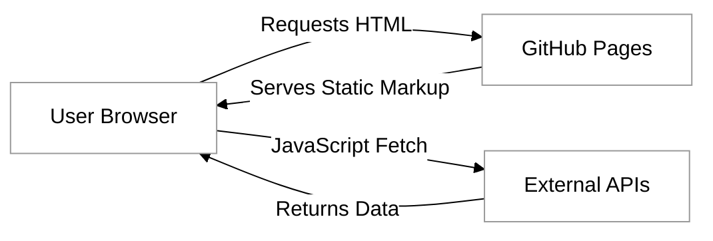
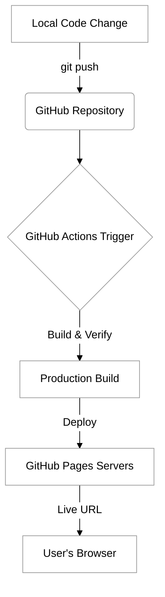

# GitHub Pages


As you build your web applications, you will quickly reach a point where viewing your work on a local machine is no longer enough. To share your creations with the world, you need a host—a computer that is always on, connected to the internet, and ready to serve your files to any browser that requests them. GitHub Pages is a powerful, streamlined service provided by GitHub that allows you to host static websites directly from your repositories. It is an essential tool in a developer's toolkit, bridging the gap between a local project and a live, public application.


### Understanding Static Web Hosting

Before diving into the technical setup, it is important to understand what "static" means in the context of GitHub Pages. A static website consists of files—HTML, CSS, JavaScript, and images—that are delivered to the user's browser exactly as they are stored on the server. Unlike dynamic websites that use server-side languages like Python, Ruby, or Node.js to build pages on the fly using a database, GitHub Pages simply serves the files you have written.

While this may sound limiting, modern web development often leans into a **Jamstack** architectural approach where your "static" site behaves like a dynamic one by shifting the work from the server to the browser.

The name is an acronym for its three core components:

*   **J**avaScript: Handles all dynamic logic on the client-side (e.g., React, Vue, or vanilla JS).
*   **A**PIs: Instead of your own server, you use external services via JavaScript to handle data (like fetching weather info or user comments).
*   **M**arkup: Pre-rendered HTML files that are served instantly from a host like GitHub Pages.



By serving pre-built files and using APIs for data, your site becomes incredibly fast and secure because there is no database or server-side language (like Python or Ruby) for hackers to attack directly. GitHub Pages is perfect for portfolio sites, documentation, and the frontend of your web applications.

### The Power of Automation with GitHub Actions

In the early days of web development, deploying a site often involved manually uploading files via FTP. GitHub Pages originally simplified this by automatically serving files from a specific branch (usually `main` or `gh-pages`). However, modern workflows often require a "build step"—perhaps you are using a preprocessor for your CSS or a framework that needs to bundle your JavaScript.

This is where GitHub Actions comes in. GitHub Actions is a continuous integration and continuous deployment (CI/CD) platform that allows you to automate your build, test, and deployment pipeline. By using a "workflow" file, you can tell GitHub: "Every time I push code to my repository, automatically check for errors and then deploy the updated version to GitHub Pages." This ensures that your live site is always in sync with your codebase without any manual intervention.

### Deployment Workflow

The following diagram illustrates the lifecycle of a deployment using GitHub Pages and GitHub Actions:



### Tutorial: Deploying Your First Site

To get started, we will create a simple project and set up an automated deployment pipeline. This tutorial assumes you have a basic understanding of Git and a GitHub account.

#### Prepare Your Repository

First, create a new public repository on GitHub named `my-web-project`. Clone this repository to your local machine. Inside the folder, create a file named `index.html` and add some basic content:

```html
<!DOCTYPE html>
<html lang="en">
<head>
    <meta charset="UTF-8">
    <title>My GitHub Pages Site</title>
</head>
<body>
    <h1>Hello, World!</h1>
    <p>This site was deployed automatically using GitHub Actions.</p>
</body>
</html>
```

Commit this file and push it to your GitHub repository.

#### Configure GitHub Pages Settings

Navigate to your repository on GitHub.com and follow these steps:
1. Click on the **Settings** tab.
2. On the left-hand sidebar, click on **Pages**.
3. Under the **Build and deployment** section, look for **Source**.
4. Change the dropdown from "Deploy from a branch" to **"GitHub Actions"**.

By selecting GitHub Actions, you are telling GitHub that you will provide a specific set of instructions for how the site should be deployed, rather than just pointing at a folder.

#### Create the Deployment Workflow

Now, we need to provide those instructions. In your local project, create a directory structure at the root level: `.github/workflows/`. Inside that folder, create a file named `deploy.yml`. 

Copy and paste the following configuration into `deploy.yml`:

```yaml
name: Deploy Static Content
on:
  push:
    branches: ["main"] # Trigger the workflow on every push to the main branch
permissions:
  contents: read
  pages: write
  id-token: write
jobs:
  deploy:
    environment:
      name: github-pages
      url: ${{ steps.deployment.outputs.page_url }}
    runs-on: ubuntu-latest
    steps:
      - name: Checkout code
        uses: actions/checkout@v4

      - name: Setup Pages
        uses: actions/configure-pages@v5

      - name: Upload artifact
        uses: actions/upload-pages-artifact@v3
        with:
          path: '.' # The directory containing your static files

      - name: Deploy to GitHub Pages
        id: deployment
        uses: actions/deploy-pages@v4
```

### Breakdown of the Workflow

This YAML file defines a **workflow**—a collection of automated steps. Here is what each part of the configuration is doing:

*   **permissions**: GitHub Actions requires explicit permission to interact with your repository's settings. `pages: write` allows the action to update your site, while `id-token: write` is required for secure authentication.
*   **actions/checkout@v4**: This action "checks out" your repository onto the GitHub runner (a temporary virtual machine), allowing the subsequent steps to access your files.
*   **actions/configure-pages@v5**: This initializes the Pages environment. It automatically detects your site's settings and prepares the runner for deployment.
*   **actions/upload-pages-artifact@v3**: This packages your files into a compressed "artifact" that GitHub Pages can consume. 
    *   **Configurable Property**: `path`. If your website files are located in a specific subfolder (like `dist`, `public`, or `build`), change `path: '.'` to `path: './dist'`.
*   **actions/deploy-pages@v4**: This takes the uploaded artifact and pushes it to the GitHub Pages hosting infrastructure.

### Finalizing the Deployment

Commit and push this new file to your repository. Once you push, navigate to the **Actions** tab in your GitHub repository. You will see a workflow run in progress. When it finishes (turning green), your site is live! You can find the live URL in the **Settings > Pages** section or on the repository's main page under the **Environments** sidebar.
### Common Challenges and Solutions

While GitHub Pages is designed to be user-friendly, you may encounter a few common hurdles:

**The 404 Error on Refresh**
If you are building a Single Page Application (SPA) using a framework like React or Vue, refreshing a subpage (e.g., `yoursite.com/about`) might result in a 404 error. This happens because GitHub Pages looks for a file named `about.html`, which doesn't exist. To solve this, developers often use a trick involving a custom `404.html` file that redirects the user back to `index.html`.

**Case Sensitivity**
Unlike Windows or macOS file systems, GitHub Pages servers are case-sensitive. If your image is named `Photo.jpg` but your HTML refers to `photo.jpg`, the image will not load on the live site even if it works perfectly on your computer. Always use consistent casing (ideally lowercase) for all filenames.

**Relative vs. Absolute Paths**
If your repository is not a "User" site (named `username.github.io`) but a "Project" site (named `my-project`), your URL will look like `username.github.io/my-project/`. If you use absolute paths like ``, the browser will look at the root of the domain, missing the project subfolder. Always use relative paths like `./logo.png` to ensure your assets load correctly.

### Summary

GitHub Pages, combined with GitHub Actions, offers a professional-grade deployment pipeline for static web projects. By moving away from manual uploads and embracing automation, you ensure that your deployment process is repeatable, transparent, and efficient. As you continue through this course, you will find that the ability to quickly iterate on your code and see those changes reflected instantly on a live URL is a foundational skill for any modern web developer.

For further exploration, consider researching:
- [GitHub Pages Official Documentation](https://docs.github.com/en/pages)
- [Using Custom Domains with GitHub Pages](https://docs.github.com/en/pages/configuring-a-custom-domain-for-your-github-pages-site)
- [GitHub Actions Marketplace](https://github.com/marketplace?type=actions) for more advanced deployment workflows.